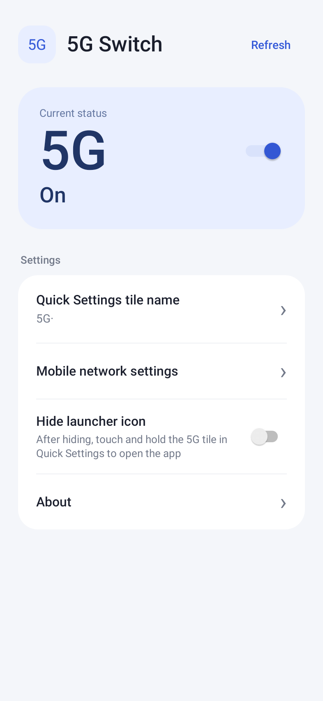
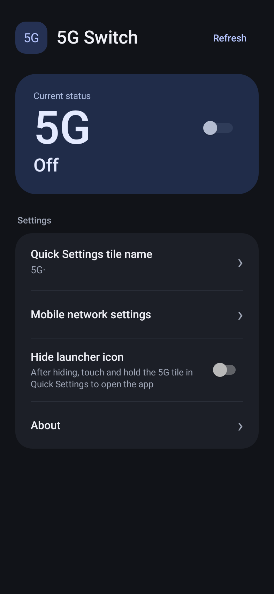

# 5G Switch

English · [简体中文](README.zh-CN.md)

Toggle 5G for your default mobile data SIM through Shizuku or Sui. Includes a Quick Settings tile, a custom tile name, light and dark themes, and an option to hide the launcher icon.

[Download APK](https://github.com/XiaoLeXLDW/5g-switch-os4-shizuku/releases/latest) · [Build from source (中文)](docs/BUILDING.md) · [MIT license](LICENSE)

## Get started

1. Install the APK on Android 11 or later, start Shizuku or Sui, and grant the app access.
2. Open the app or add its **5G·** tile to Quick Settings to toggle 5G. The app changes only the default data SIM's 5G preference and reads the result back from the system.
3. To hide the launcher icon, add the tile first. Once hidden, long-press the tile to open the app; turn off **Hide launcher icon** to restore the icon.

## Languages

The current source supports **English**, **Simplified Chinese**, and **Traditional Chinese**. The interface follows the system language, with English as the fallback. Android 13 and later also support choosing the app language in system settings. Your custom tile name is preserved when the language changes.

## Compatibility

**v1.1.1** was confirmed usable on a Xiaomi 17 Ultra Leica Edition (HyperOS 4, OS 4.0.4.0 / Android 17), using Stellar activation. Physical device validation of v1.2.0 is pending.

Android 11 is the minimum supported SDK version; behavior on other devices depends on the ROM and its telephony APIs. Enabling 5G permits the network mode; actual 5G connectivity depends on your SIM, carrier, and coverage.

## Screenshots

 

These are local test renders of the English interface. The app and tile icons are drawn with the system sans-serif font; no font file is bundled.

See [third-party notices](THIRD_PARTY_NOTICES.md).
