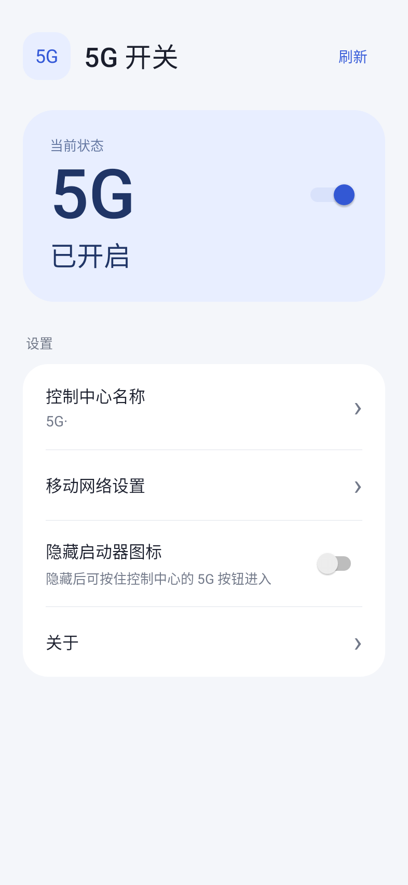
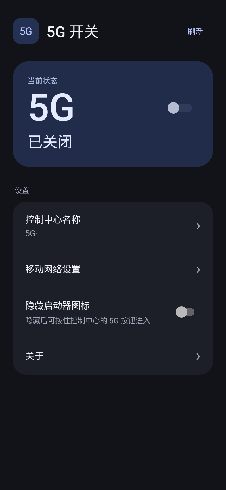

# 5G Switch

通过 Shizuku / Sui 切换默认数据卡的 5G，支持控制中心磁贴、名称修改、深浅主题和隐藏启动器图标。

**v1.0.0 已在小米 17 Ultra 徕卡版（OS 4.0.4.0 / Android 17）上测试，使用 Stellar 激活。**

[下载 APK](https://github.com/XiaoLeXLDW/5g-switch-os4-shizuku/releases/latest) · [构建](docs/BUILDING.md) · [MIT](LICENSE)

安装后允许 Shizuku 授权即可使用。磁贴默认名称为 `5G·`，只修改 5G 开关，状态以系统读回为准。

开启“隐藏启动器图标”前，先将 5G 按钮添加到控制中心。隐藏后按住控制中心的 5G 按钮即可进入应用，关闭该开关可恢复图标。

界面和控制中心的 5G 图标使用系统无衬线字体；图标在运行时以常规字重绘制，跟随系统字形，不内置字体文件。

v1.1.1 已在 MIX Fold 2（HyperOS 3.0.8.0 / Android 15）上实测 5G 开关及系统读回、隐藏与恢复桌面图标、隐藏后磁贴切换和长按进入。该机使用 Shizuku；上述 Android 17 设备的 v1.1.1 同机验证仍待确认。

 

应用为原生源码重写，保留旧入口名称用于覆盖升级，不包含原 APK 的代码或界面资源。

界面示例为本机渲染图。[第三方许可](THIRD_PARTY_NOTICES.md)。
